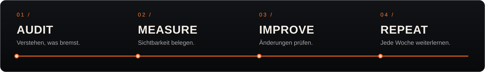

<div align="center">


<br>


### In der Suche gefunden. In KI-Antworten vertreten.

Ein Skill für **SEO-Audits, messbare KI-Sichtbarkeit und kontinuierliche Verbesserungen**.
Von der ersten Diagnose bis zum geprüften Fix und zum nächsten Wochenreport.

**[Skill öffnen](skills/seo-geo/SKILL.md)** &nbsp; · &nbsp; **[Schnellstart](#schnellstart)** &nbsp; · &nbsp; **[GEO messen](#geo-messen)** &nbsp; · &nbsp; **[Quellen](skills/seo-geo/references/sources.md)**

</div>

<br>



## Sichtbarkeit braucht einen nachvollziehbaren Prozess.

VENOX SEO + GEO verbindet technische Suchmaschinenoptimierung mit einer sauberen Messung von KI-Antworten. Jede Empfehlung bekommt einen Beleg, jede Änderung eine Prüfung und jede Auswertung einen klaren Messrahmen.

| | Was der Skill übernimmt |
|:--|:--|
| **01 / AUDIT** | Technisches SEO, Indexierbarkeit, Rendering, Metadaten, strukturierte Daten, Inhalte und relevante Crawler prüfen. Findings mit Evidenz, Priorität und konkreter Abhilfe dokumentieren. |
| **02 / MEASURE** | Versionierte Prompt-Panels aufbauen. Erwähnungen, sichtbare Zitate, Empfehlungen und Antwortgenauigkeit getrennt erfassen. Markt, Sprache, Modell und Messmethode festhalten. |
| **03 / IMPROVE** | Passende Code- und Inhaltsänderungen im beauftragten Umfang umsetzen. Vorher/Nachher, technische Prüfung, Release-Status und spätere Wirkung nachvollziehbar halten. |
| **04 / REPEAT** | Vergleichbare Wochenberichte erstellen, Datenlücken offenlegen und die nächsten Maßnahmen aus tatsächlichen Beobachtungen ableiten. |

## Schnellstart

### Im Agenten

Den Ordner [`skills/seo-geo`](skills/seo-geo) in das jeweilige Skill-Verzeichnis kopieren oder verlinken:

| Agent | Installationsort |
|:--|:--|
| **Codex** | `$CODEX_HOME/skills/seo-geo` oder `~/.codex/skills/seo-geo` |
| **Claude Code** | `~/.claude/skills/seo-geo` |

Vorhandene Installationen erhalten. Falls nötig, die Skill-Liste des Agenten neu laden.

```text
Nutze $seo-geo für einen SEO/GEO-Audit von https://example.com.
Priorisiere belegte Probleme, bereite konkrete Verbesserungen vor
und erstelle einen wiederholbaren Messplan.
```

### Mit den Hilfsprogrammen

**Python 3.10+ · Standardbibliothek · keine zusätzlichen Laufzeitpakete.**

```bash
# Kundenprojekt mit einem anpassbaren Prompt-Set anlegen.
python3 skills/seo-geo/scripts/geo.py init \
  --out ./client \
  --domain example.com \
  --brand Example \
  --category Terminsoftware

# Messlauf planen. Dieser Aufruf sendet keine API-Anfragen.
python3 skills/seo-geo/scripts/geo.py collect \
  --config ./client/project.json \
  --out ./client/runs/plan
```

Bezahlte Erfassung benötigt freigeschaltete Anbieter, aktuelle Modell-IDs, Zugangsdaten als Umgebungsvariablen und den ausdrücklichen Parameter `--live`. Die erzeugten Prompts sind ein Ausgangspunkt und werden vor einer Baseline an echte Kundenfragen angepasst.

## GEO messen

**Wie oft taucht eine Marke bei den relevanten Fragen tatsächlich auf?**

Der Skill arbeitet mit festen Intents, wiederholten Erfassungen und gespeicherten Rohbelegen. Raten enthalten Treffer und Stichprobengröße; unbekannte Daten bleiben unbekannt. Echte Produktoberflächen und API-Proxys werden separat ausgewertet.

| Messweg | Abdeckung |
|:--|:--|
| **Direkte API-Adapter** | OpenAI Responses mit Websuche · Perplexity Agent API · Gemini mit Google Grounding |
| **Belegter UI-/SERP-Import** | Beispielsweise ChatGPT Search, Gemini, Claude, Copilot sowie Google AI Overviews und AI Mode; Import normalisierter JSONL-Captures |
| **First-Party-Daten** | Vorhandene Connectoren oder Exporte aus Search Console, Bing Webmaster Tools, GA4 und CRM |

Ein API-Ergebnis belegt die entsprechende API-Stichprobe. Für die Sichtbarkeit im Consumer-Produkt werden dessen eigene Captures benötigt. Der Skill trennt außerdem technische Bereitschaft, Zitationen, Empfehlungen, Besuche und Conversions.

→ **[Messmethodik](skills/seo-geo/references/measurement.md)** · **[Plattformen und Datenzugänge](skills/seo-geo/references/platforms-and-data.md)**

## Jede Woche ein konkreter nächster Schritt.

Ein Wochenreport verbindet die Entwicklung der Kennzahlen mit dem, was tatsächlich verändert wurde:

- SEO- und Geschäftsdaten mit Zeitraum, Quelle und Datenstand.
- KI-Sichtbarkeit je Oberfläche, Methode, Markt und Prompt-Kohorte.
- Geprüfte Änderungen, vorbereitete Patches und noch offene Wirkungsmessungen.
- Priorisierte nächste Schritte mit Beleg und Verifikationsmethode.

Der wiederkehrende Betrieb wird je Kunde eingerichtet: mit Zielwebsite, Datenzugängen, Zeitpunkt, Reportziel und erlaubtem Änderungsumfang. Der Skill enthält den Ablauf und die Scheduler-Vorlage; die Installation allein startet keinen Hintergrundjob.

→ **[Wochenbetrieb und Automatisierung](skills/seo-geo/references/weekly.md)**

## Unter der Haube

| Einstieg | Inhalt |
|:--|:--|
| [`SKILL.md`](skills/seo-geo/SKILL.md) | Arbeitsweisen, Entscheidungsregeln und Auftragsgrenzen |
| [`audit-and-fix.md`](skills/seo-geo/references/audit-and-fix.md) | Audit, konkrete Korrekturen und Verifikation |
| [`content-and-authority.md`](skills/seo-geo/references/content-and-authority.md) | Inhalte, Entitäten, belastbare Aussagen und Antwortgenauigkeit |
| [`geo.py`](skills/seo-geo/scripts/geo.py) | Projekt anlegen, Messläufe planen/erfassen, Captures importieren und Reports vorbereiten |
| [`page_audit.py`](skills/seo-geo/scripts/page_audit.py) | Begrenzte Prüfung des initialen HTML mit gespeicherten Headern und robots.txt |
| [`sources.md`](skills/seo-geo/references/sources.md) | Bekannte Skill-Ansätze, Auswahlentscheidungen und aktuelle Primärquellen |

## Nachprüfbar gebaut

```bash
python3 -m unittest discover -s tests -v
```

Die Tests prüfen unter anderem Fehlerbehandlung, Zitierabdeckung, Domain-Erkennung, Oberflächentrennung, Zeitfenster und den Report-Workflow. Ein zusätzlicher Anwendungstest umfasst zwei Wochen mit ausdrücklich synthetischen Rohbelegen.

**[Validierung und bekannte Grenzen](evals/validation.md)** dokumentieren den tatsächlichen Nachweis. Live-API-Zugänge und reale Kundenmessungen werden beim Einsatz separat geprüft. Rankings oder Zitationen sind kein garantiertes Ergebnis.

<br>

<div align="center">


**VENOX** &nbsp; / &nbsp; SEARCH. ANSWERS. IMPACT.

<sub>Audit with evidence. Improve with intent. Repeat with insight.</sub>

</div>
